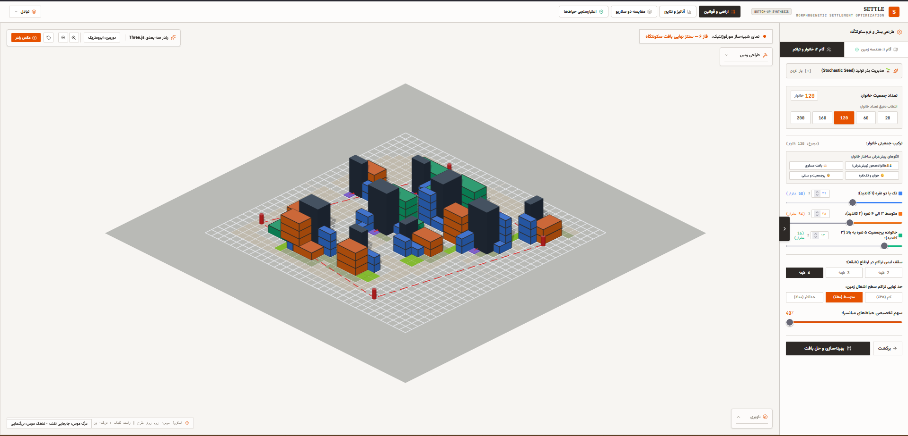
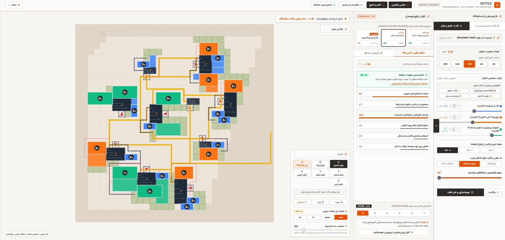
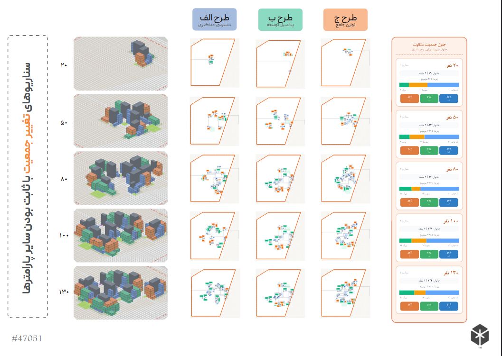
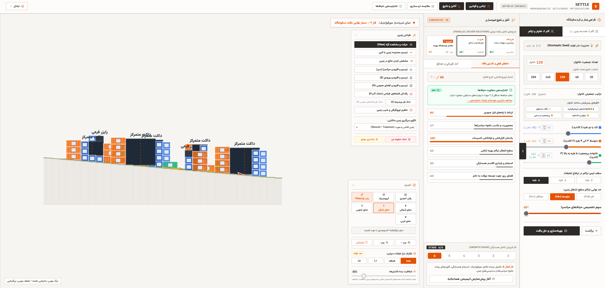

<div dir="rtl" align="right">

# SETTLE (v3.0.0) — موتور بهینه‌سازی مورفوژنتیک سکونتگاه

SETTLE یک پلتفرم طراحی مولد و بهینه‌سازی برای **سکونتگاه‌های کانتینری اضطراری پس از بلایا** است. این سامانه با یک الگوریتم رشد تصادفی، آگاه از توپوگرافی و **زیرساخت‌محور** طرح‌های سکونتگاهی تولید می‌کند که جان انسان‌ها، بهره‌وری منابع و لجستیک عملیاتی را در اولویت قرار می‌دهند و از چارچوب‌های طراحی بشردوستانه (OCHA/UNHCR) الهام گرفته‌اند.

**دمو آنلاین:** `[لینک دمو]`  ·  **ویدیوی معرفی:** `[لینک ویدیو]`  ·  **رقابت:** `[نام رقابت / دسته]`

---

## 🚀 نوآوری‌های معماری در نسخه ۳٫۰٫۰

برخلاف مولدهای چیدمان صرفاً اکتشافی، SETTLE نسخه ۳٫۰٫۰ یک **چارچوب زیرساخت‌محور (Infrastructure-First)** معرفی می‌کند:

* **تخصیص قطعی ورودی و ستون فقرات حرکتی:** تحلیل نقطه‌ی میانی مرز زمین همراه با تغییرات شیب محلی، برای لنگرانداختن شریان اصلی تردد.
* **جانمایی هسته‌ها بر پایه توپوگرافی:** هسته‌های خدماتی با فاصله‌ی پیاده‌روی و بردارهای ارتفاعی (جریان ثقلی) محدود می‌شوند تا مسیر فاضلاب و آب بهینه باشد.
* **اولویت‌دهی به گروه‌های آسیب‌پذیر:** قرارگیری در تراز همکف و نزدیکی به هسته برای خانوارهای چندنسلی یا دارای افراد دارای معلولیت.
* **شبکه‌ی حرکتی سلسله‌مراتبی:** تفکیک جریان فضایی به شریان‌های اصلی، اتصال‌دهنده‌های ثانویه‌ی کلاستر و مسیرهای پیاده‌ی داخلی.

---

## 📸 معرفی رابط کاربری و شبیه‌سازی

<!-- عکس‌ها را در پوشه‌ی assets/ با همین نام‌ها قرار دهید -->

### ۱. موتور سه‌بعدی حجمی یکپارچه
خط تولید مولد، چیدمان‌های حجمی کامل را با سایه‌زنی مبتنی بر عمق نمایش می‌دهد تا مکانیک پشته‌چینی کانتینرها، سایه‌های پویا و پروفایل تراکم روی زمین‌های پیچیده بررسی شود.



### ۲. مسترپلان مولد دوبعدی و نمای تحلیل
رابط کاربری تحلیل‌های عمیقی ارائه می‌دهد: پهنه‌بندی عملکردی، امتیازدهی چندهدفه (دسترسی پیاده، راندمان تاسیسات MEP، نسبت حیاط‌ها) و آرایه‌های خودکار تعادل انواع واحد.



### ۳. گزارش جامع عملکرد
پنل پایش داده‌محور، شاخص‌های انسجام هسته‌ها و توزیع جمعیت را می‌سنجد و تشخیص‌های فضایی ارائه می‌دهد که با فهرست‌های کنترل برنامه‌ریزی اردوگاه‌های بشردوستانه مقایسه می‌شوند.



### ۴. نمای مقطع مهندسی
پایداری پشته‌ی عمودی، پروفایل سازه‌ای واحدها و راستای رایزرهای تاسیساتی را روی زمین‌های شیب‌دار ارزیابی می‌کند.



---

## 🎯 هدف پروژه و محدوده‌ی ادعا

**هدف:** کمک به طراح در **مرحله‌ی مفهومی**: تولید سریع چند چیدمان معتبر از نظر قواعد هندسی و مقایسه‌ی نسبی آن‌ها، پیش از ورود به طراحی تفصیلی.

**آنچه SETTLE نیست:**
* جایگزین تحلیل سازه‌ای، طراحی تاسیسات یا بررسی آیین‌نامه‌ای (حریق، خروج اضطراری، نورگیری) نیست.
* امتیازها شاخص‌های **اکتشافی و نسبی** هستند؛ هنوز با طرح‌های واقعی یا نظر متخصصان اعتبارسنجی نشده‌اند.
* «الهام از OCHA/UNHCR» به معنای گواهی انطباق با استانداردها نیست.
* بهینه‌ساز، نمونه‌گیری تصادفی و رتبه‌بندی است و یافتن بهینه‌ی سراسری را تضمین نمی‌کند.

---

## 🛠️ ساختار ماژولار پروژه

کد پروژه به‌صورت معماری لایه‌ای و مجزای TypeScript سازمان‌دهی شده است:

```text
src/
├── App.tsx                      # کامپوننت ورودی اصلی برنامه
├── generator.ts                 # هماهنگ‌کننده‌ی خط تولید
├── index.css                    # استایل‌های سراسری Tailwind و تم بوم
├── main.tsx                     # نصب React DOM و تزریق context
├── types.ts                     # تعریف تایپ‌های مشترک سراسری
│
├── algorithms/
│   └── spine/
│       └── spine-generator.ts   # مسیریاب ستون فقرات بر پایه هزینه-فاصله آگاه از توپوگرافی
│
├── components/
│   ├── Dashboard.tsx            # چیدمان اصلی میزبان پنل‌ها و کنترل‌ها
│   ├── HelpOverlay.tsx          # راهنمای میانبرها و آشنایی کاربر
│   ├── InteractiveCanvas.tsx    # مدیریت رویدادهای ماوس/درگ روی زمین
│   ├── ParamsPanel.tsx          # ورودی‌های پیکربندی وزن‌های مورفوژنتیک
│   ├── PhasesPanel.tsx          # ردیاب بصری مراحل در حال اجرای خط تولید
│   ├── ReportModal.tsx          # مودال خلاصه‌ی شاخص‌ها برای طرح‌های خروجی
│   ├── ResultsPanel.tsx         # نمایش آمار تحلیلی خروجی
│   ├── SettlementCanvas.tsx     # موتور رندر WebGL/2D برای عناصر طرح
│   ├── ToolsPanel.tsx           # انتخاب ابزار (معابر، مرز، قلم‌ها)
│   ├── Tour.tsx                 # تور راهنمای گام‌به‌گام تعاملی
│   └── Wizard.tsx               # ماژول پیکربندی متوالی (ویزارد)
│
├── constants/
│   └── stages.ts                # مشخصات پیکربندی مراحل تکرار خط تولید
│
├── core/
│   └── types/
│       └── context.ts           # کانتینر یکپارچه‌ی وضعیت داخلی و رجیستری
│
├── domain/
│   └── terrain/
│       └── entry-point.ts       # لنگرهای ورودی و محاسبه‌ی مرکز مرز زمین
│
├── features/
│   └── generation/
│       └── infrastructure-first.ts # الگوریتم رویه‌ای چندهدفه
│
├── generator/
│   ├── core-generator.ts        # تبدیل‌های ماتریسی تکرارشونده برای سازه‌ها
│   ├── evaluator.ts             # امتیازدهی برازندگی بر پایه ویژگی‌های جغرافیایی
│   ├── helpers.ts               # نمونه‌گیرهای ماتریسی و توابع ریاضی کمکی
│   ├── index.ts                 # خروجی یکپارچه‌ی ماژول‌های مولد
│   ├── pathfinding.ts           # پیاده‌سازی A* روی گرید برای مسیرهای ثانویه
│   └── types.ts                 # تایپ‌های داخلی الگوریتم‌های تولید
│
├── hooks/
│   └── useSettlement.ts         # مدیر مرکزی وضعیت، اتصال UI به هسته
│
└── utils/
    └── projection.ts            # تبدیل مختصات ماتریسی و ابزار نگاشت
```

---

## ▶️ اجرای پروژه

پیش‌نیاز: Node.js

```bash
npm install
npm run dev      # http://localhost:3000
npm run build
npm run lint
```

**فناوری‌ها:** React، TypeScript، Vite، Tailwind CSS، Three.js.

---

## 🧭 قدم‌های بعدی

- [ ] اعتبارسنجی امتیازها و وزن‌ها با بازخورد معماران و دست‌کم یک طرح مرجع واقعی.
- [ ] افزودن آزمون خودکار برای قواعد جایگذاری و مسیریابی.
- [ ] ذخیره‌ی کامل وضعیت ویرایش‌شده در JSON و بازگرداندن آن (امروز فقط پارامترها و بذر بازیابی می‌شوند).
- [ ] اجرای تولید در Web Worker برای زمین‌های بزرگ.
- [ ] لایه‌ی بررسی ضوابط (حریق، خروج اضطراری، نورگیری) با قواعد قابل پیکربندی.
- [ ] کنترل سازه‌ای ابتدایی با همکاری مهندس سازه.
- [ ] بهینه‌سازی چندهدفه‌ی واقعی (مانند NSGA-II) و نمایش جبهه‌ی پارتو.
- [ ] کامپوننت آماده‌ی Rhino/Grasshopper برای خواندن خروجی JSON.

---

## 👥 تیم و مجوز

- **تیم:** `[نام اعضا و نقش‌ها]`
- **مجوز:** `[Apache-2.0 یا مجوز دلخواه؛ فایل LICENSE را اضافه کنید]`

</div>
